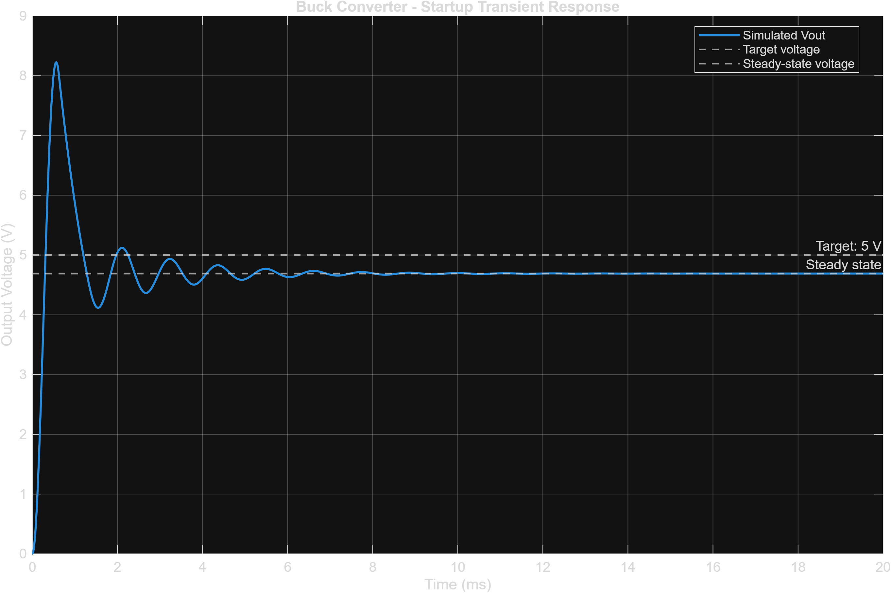
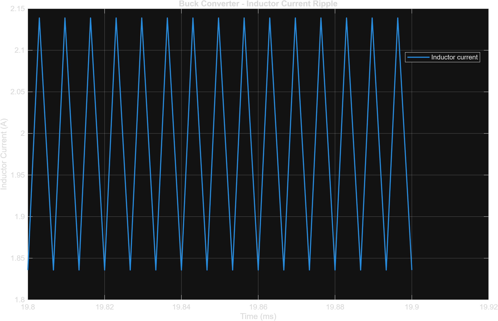
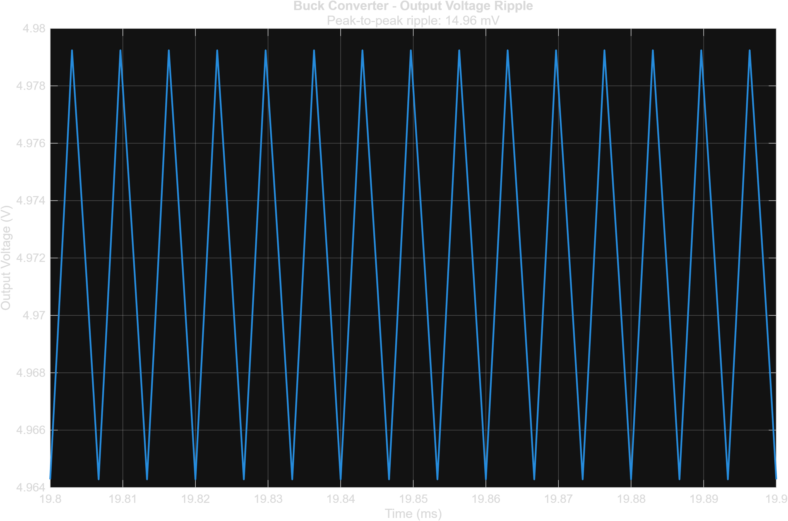
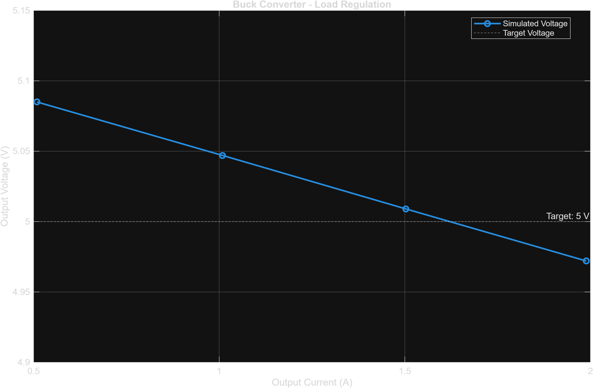
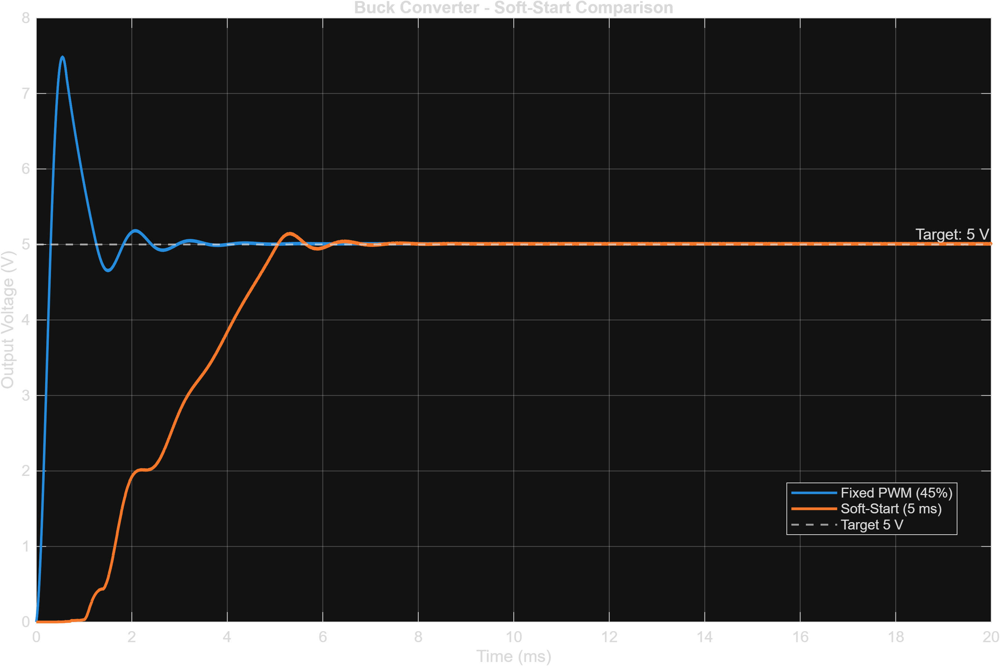
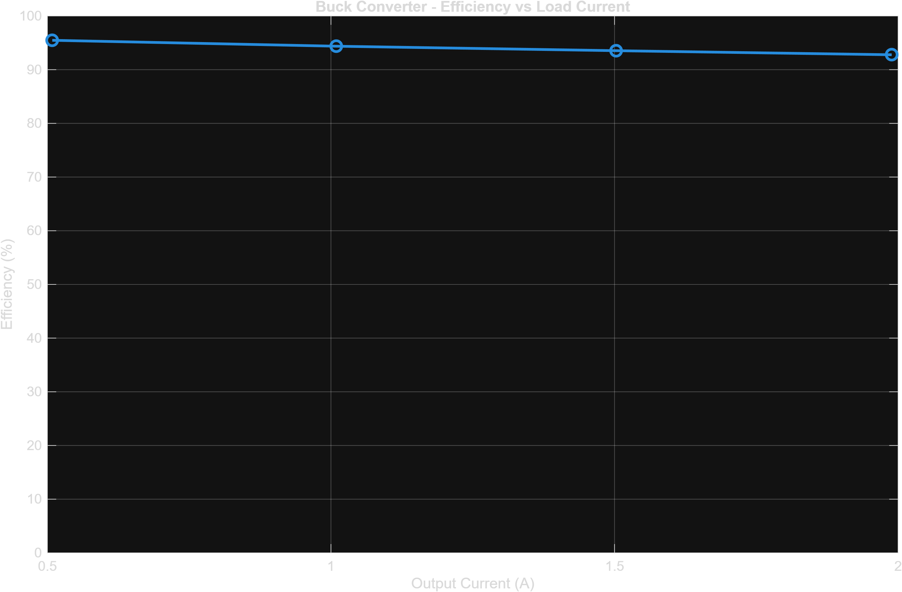

# DC-DC Buck Converter | 12V to 5V, 2A

**Custom PCB Design & Power Electronics Simulation**

A personal electrical engineering project focused on designing and analyzing a 12V-to-5V DC-DC buck converter capable of supplying a target output current of 2A.

The project combines PCB design in KiCad, theoretical power electronics calculations, and MATLAB/Simulink simulations.

**Project Status:** PCB designed; hardware assembly and testing pending.

## Project Objectives

- Design a custom two-layer PCB using KiCad.
- Implement an adjustable LM2596-based buck converter.
- Convert a nominal 12V DC input to a regulated 5V output.
- Target an output current of up to 2A.
- Model switching behavior using MATLAB and Simscape Electrical.
- Analyze startup response, inductor current, voltage ripple, load regulation, and efficiency.
- Compare simulation results against physical measurements after PCB assembly.

## Technical Specifications

| Parameter | Value |
|---|---|
| Input Voltage | 12V DC nominal |
| Target Output Voltage | 5V DC |
| Target Output Current | 2A |
| Target Output Power | 10W |
| Regulator IC | LM2596T-ADJ |
| Switching Frequency | 150 kHz |
| Inductor | 68 µH |
| Output Capacitor | 470 µF |
| PCB | Custom 2-layer PCB |

## Technologies Used

- **KiCad:** Circuit schematic, PCB layout and Gerber generation
- **MATLAB:** Numerical calculations, signal analysis and visualization
- **Simulink / Simscape Electrical:** Switching circuit simulation
- **LTspice:** Circuit simulation tool for subsequent validation

## MATLAB/Simulink Simulation

A simplified open-loop buck converter was modeled using a fixed 45% PWM duty cycle at 150 kHz.

The model includes an inductor series resistance of 0.067 Ohm and an assumed output capacitor ESR of 0.05 Ohm.

The open-loop model is not an exact representation of the LM2596 internal feedback controller.

### Startup Transient Response



The fixed-PWM model exhibits transient overshoot and damped oscillations before approaching steady-state operation.

### Inductor Current Ripple



The simulated inductor current is approximately 2A with a peak-to-peak ripple of about 0.303A under the nominal load condition.

### Output Voltage Ripple



The simulated steady-state output voltage ripple is approximately 14.96mV peak-to-peak with the assumed capacitor ESR.

### Load Regulation



The fixed-duty-cycle model shows a gradual decrease in output voltage as load current increases.

### Soft-Start Investigation



A separate simulation explored a 5ms duty-cycle ramp to reduce startup overshoot.

At approximately 1.5A output current, the simulated startup peak decreased from about 7.489V with fixed PWM to 5.150V with the ramped-duty-cycle strategy.

**Note:** The soft-start investigation is simulation-only and does not represent an implemented soft-start circuit on the LM2596 PCB.

## Efficiency Analysis



Simulated performance across four resistive load conditions:

| Output Current | Output Voltage | Simulated Efficiency |
|---|---|---|
| 0.509 A | 5.086 V | 95.47% |
| 1.010 A | 5.047 V | 94.37% |
| 1.503 A | 5.009 V | 93.54% |
| 1.989 A | 4.972 V | 92.78% |

Input and output powers were calculated using time-weighted integration in MATLAB.

A maximum simulation step of 0.1 microseconds was used to improve the accuracy of switching-waveform analysis.

These values represent the simplified Simscape model, not measured efficiency of the physical LM2596 converter.

## Repository Structure

```text
DC_DC_Buck_Converter/
├── README.md
├── MATLAB_Simulink/
│   ├── Models/
│   ├── Scripts/
│   ├── Results/
│   │   ├── Figures/
│   │   └── Data/
│   └── Documentation/
│       └── DC_DC_Buck_Converter_Simulation_Report.docx
└── KiCad design files
```

## Technical Report

[View the Design and Simulation Report](MATLAB_Simulink/Documentation/DC_DC_Buck_Converter_Simulation_Report.docx)

The report documents the simulation methodology, results, limitations and planned hardware validation.

## Hardware Validation Plan

After PCB manufacturing and assembly, the following tests are planned:

1. Verify PCB assembly and electrical continuity.
2. Perform initial power-up using a current-limited 12V supply.
3. Measure the unloaded output voltage.
4. Test output regulation at approximately 0.5A, 1A, 1.5A and 2A.
5. Measure input and output current and voltage.
6. Calculate experimental conversion efficiency.
7. Compare experimental results with MATLAB/Simulink predictions.
8. Investigate component heating and output ripple where suitable measurement equipment is available.

## Project Status

- [x] Circuit design and component selection
- [x] Custom PCB layout in KiCad
- [x] PCB design-rule check
- [x] MATLAB theoretical calculations
- [x] Simulink switching circuit model
- [x] Startup and ripple analysis
- [x] Load regulation analysis
- [x] Soft-start simulation investigation
- [x] Simulated efficiency analysis
- [x] Simulation report
- [ ] PCB assembly
- [ ] Hardware performance measurements
- [ ] Simulation-to-hardware comparison

## Author

Electrical Engineering Student  
Concordia University, Montreal, Canada
